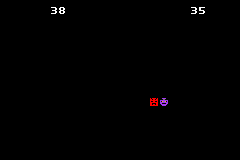

# Wraparound Run

A Game Boy Advance survival game built in C++ with Butano. Dodge the enemies chasing you for as long as you can, and try to beat your high score. Grab power-ups for a temporary speed boost or invincibility, and slip off one edge of the screen to reappear on the other to escape the enemys.

## Play it

[Play the game here](https://bmitzel88.github.io/hot-pursuit/)